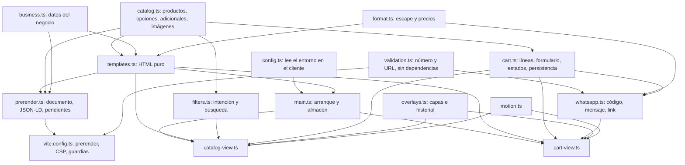
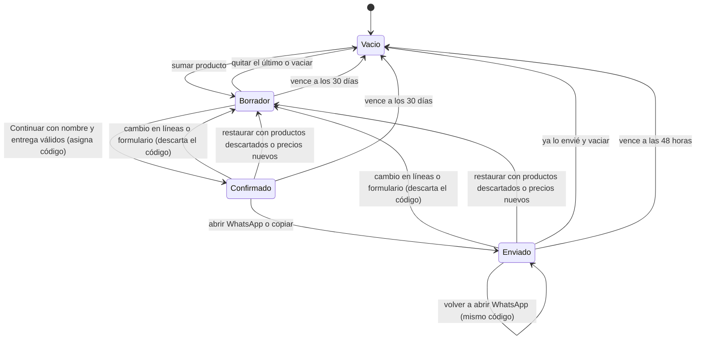
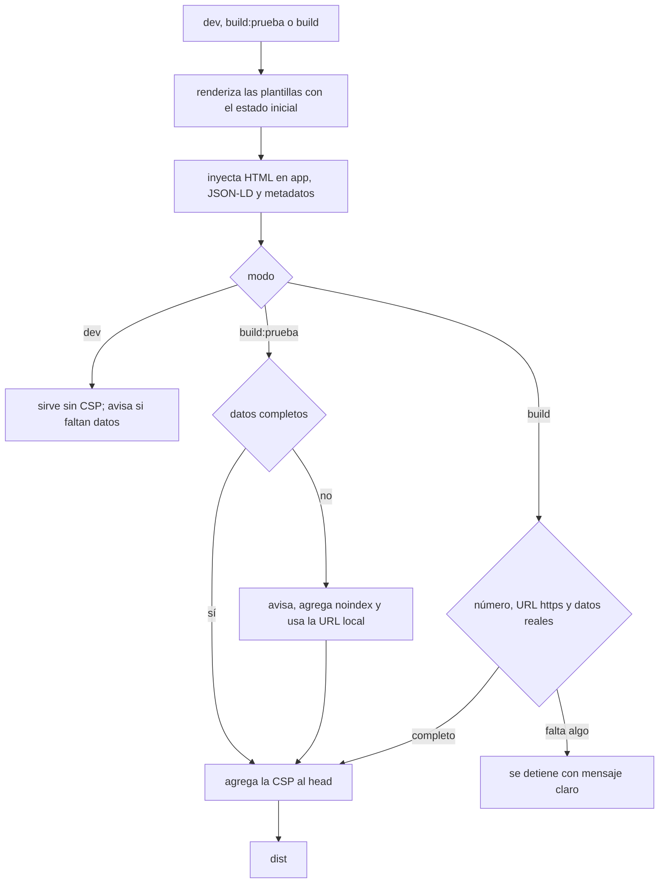

# feat: Pulido UX/UI y pedido completo de StudioAGS

## Summary

Se separa el código del cliente en módulos puros dentro de `src/`, sin carpetas nuevas. Sobre esa base se rehacen el modelo del catálogo, el pedido, el mensaje de WhatsApp y las plantillas HTML, que Vite también usa para generar la página estática con metadatos y CSP. Encima van el sistema visual, la interacción del catálogo y del pedido, las microinteracciones y las imágenes sacadas del PDF original.

---

## Problem Frame

La tienda funciona, pero se ve sin retocar: imágenes que son páginas del PDF recortadas, textos de 9–10 px, contrastes bajo AA, itálicas que no cargan, un desplegable de 20 opciones, precio que no cambia, pedido que se borra, avisos tapados por el panel, link sin vista previa y ningún dato de confianza (see origin: `requisitos-pulido.md`).

Técnicamente, todo vive en `src/main.ts`: estado global mutable, render completo por `innerHTML` (incluido en cada tecla del buscador), efectos al importar y lógica pura mezclada con DOM. No hay tests, no hay `vite.config`, la página construida llega con `#app` vacío y el número de WhatsApp se valida recién cuando la clienta toca enviar. `gsap` está instalado y no se usa. El CSS tiene unos 30 colores escritos a mano, solo dos breakpoints, hover sin `@media (hover: hover)` y ningún estado `:active`.

El proyecto todavía no está bajo git.

---

## Requirements

Se trasladan R1–R35 del documento de origen; el texto completo está allí.

**Identidad visual y copy**

- R1. Paleta, tipografías y personalidad actuales; itálicas reales sin salto al cargar.
- R2. Texto de lectura ≥ 14 px; campos de formulario a 16 px en celular.
- R3. Contraste AA en texto; 3:1 en bordes de controles y badge.
- R4. Copy revisado: voseo concreto, sin repeticiones, sin voz de desarrollador ni anglicismos.

**Catálogo y tarjetas**

- R5. Foto real recortada del catálogo como imagen principal, nítida en alta densidad.
- R6. "Ver ficha" con la página del catálogo ampliable, accesible y cerrable con Escape o tocando afuera.
- R7. Opciones con botones por atributo; adicionales separados de las variantes.
- R8. Precio en vivo, botón de sumar que refleja la elección y unidad aclarada cuando corresponde.
- R9. Marca de personalizable y plazo en cada tarjeta.
- R10. Filtros por intención, con productos en más de uno, y búsqueda.
- R11. Filtrar y buscar sin parpadeo, sin saltos, sin perder foco y sin anuncios por tecla.

**Pedido y WhatsApp**

- R12. El pedido sobrevive a la recarga y a la vuelta de WhatsApp.
- R13. Acceso fijo al pedido en celular cuando hay productos.
- R14. Formulario: nombre y entrega obligatorios; localidad si es envío; fecha; "Contanos tu idea" por producto personalizable.
- R15. Mensaje ordenado con código de pedido, líneas, subtotal, entrega, ideas y aviso de fotos.
- R16. Aviso de "solo falta tocar Enviar" y alternativa para copiar el pedido.
- R17. Después de abrir WhatsApp: vaciar o volver a enviar.
- R18. Avisos y errores dentro del panel.
- R19. Cambiar cantidades mantiene el foco y anuncia la cantidad.

**Confianza**

- R20. Bloque de plazos, envíos y retiro, pagos, muestra antes de imprimir, cambios, Instagram y tiempo de respuesta.
- R21. "Precios actualizados al [fecha]" y total a confirmar por WhatsApp.
- R22. Instrucciones para mandar fotos en los productos que las llevan.

**Interacción y movimiento**

- R23. Estados hover, foco y presionado coherentes, con equivalente táctil.
- R24. Microinteracciones puntuales y sin efectos de carga simulados.
- R25. "Reducir movimiento" respetado en CSS y JS, incluido el desplazamiento.

**Responsive y accesibilidad**

- R26. Sin scroll horizontal de 360 a 1280+ px; orden visual igual al orden de teclado.
- R27. Controles principales de al menos 44 px.
- R28. WCAG 2.2 AA: foco visible, regiones vivas sin ruido, nombres accesibles únicos.

**Compartir, buscadores y rendimiento**

- R29. Vista previa al compartir en WhatsApp e Instagram.
- R30. Contenido principal disponible sin JavaScript.
- R31. Favicon, `es-AR` y datos estructurados con precios en ARS.
- R32. Imágenes al tamaño justo y primera pantalla rápida en móvil.

**Seguridad y robustez**

- R33. No se prepara para publicar sin número de WhatsApp válido.
- R34. Texto escapado y solo recursos propios, Google Fonts y WhatsApp.
- R35. Sin dependencias sin uso.

**Origin actors:** A1 (clienta o cliente, mayormente en celular desde Instagram), A2 (dueña, cierra cada pedido por WhatsApp).
**Origin flows:** F1 (pedido desde Instagram), F2 (volver después de WhatsApp), F3 (computadora sin WhatsApp).
**Origin acceptance examples:** AE1 (Tarjetas 200 · doble faz · laminado = $26.300), AE2 (pedido sobrevive la recarga), AE3 (Láminas sin campo de idea), AE4 (faltan nombre o entrega), AE5 (copiar en computadora sin WhatsApp), AE6 (reducir movimiento), AE7 (preparar para publicar sin número falla).

El botón "Continuar por WhatsApp" que nombran AE4 y AE5 se divide en este plan en "Continuar" (valida y confirma) y el enlace a WhatsApp que aparece después; los tests de U7 siguen esa división.

---

## Scope Boundaries

- Mercado Pago o cualquier pago online.
- Fichas completas por producto con link propio.
- Vista previa en vivo de la personalización.
- Sesión de fotos nueva.
- Cambio de identidad hacia la estética pop del catálogo.
- Prueba social (fotos de clientas, capturas, reseñas).
- Hosting, dominio y publicación.
- Sincronizar el pedido entre pestañas abiertas a la vez: gana la última escritura.

### Deferred to Follow-Up Work

- Alojar las fuentes en el propio sitio (permitiría `preload` y `font-src 'self'`).
- Cabeceras de seguridad que solo funcionan desde el hosting (`frame-ancestors`, `report-uri`), cuando se elija dónde publicar.
- Medir el origen de los pedidos (por ejemplo `?ref=ig` incluido en el mensaje).
- Lighthouse automatizado en un pipeline de integración.

---

## Context & Research

### Relevant Code and Patterns

- `src/main.ts`: estado en variables de módulo, `renderPage`/`renderProducts`/`renderCart` con `innerHTML`, eventos delegados en `document` por `data-action` (se conserva el patrón: facilita hidratar sin re-enlazar), `escapeHtml` y `formatPrice` ya existen, y ya hay un estado vacío del pedido ("Tu pedido empieza acá.") que se conserva.
- `src/catalog.ts`: las variantes de Tarjetas ya se generan desde una matriz cantidad × faz × terminación; el ID actual depende del índice, lo que rompe pedidos guardados si se reordena.
- `src/styles.css`: tokens en `:root`, secciones en orden de página, breakpoints de 980 y 680 px, bloque `prefers-reduced-motion` universal con `!important`. Trampas: `.search-field input { outline: 0 }` anula el foco; las fotos del hero ya usan `rotate()` (cualquier transform nuevo tiene que componerlo); `column-reverse` a 980 px desordena el teclado; el toast está por debajo del top layer del `<dialog>`. La tarjeta mide hasta 520 px CSS en una columna, así que en pantallas 2× pide hasta ~1040 px de imagen.
- `tsconfig.json` incluye solo `src` y tiene `noEmit`; referenciar desde ahí otro proyecto con `noEmit` hace fallar `tsc -b` (TS6306/TS6310, comprobado con TypeScript 5.9.3).
- `transitions/*.md`: recetas en HTML + CSS con variables + JS opcional, sin dependencias. Se usan `number-pop-in`, `text-states-swap`, `notification-badge`, `tabs-sliding` (solo el indicador, con semántica de radio) y `card-tilt` (sin `touch-action: none`, solo con puntero fino).
- PDF original del catálogo (`14-7-2026.pdf`, fuera del repo, 36 páginas de 613 × 860 pt): los precios coinciden con `src/catalog.ts`; las fotos embebidas están colocadas a unos 300 dpi y miden de 364 a 782 px de ancho (Láminas 364, Vinilos 369, Bitácoras 448, Fotos 585, Tarjetas 692, Pizarra 782); las páginas de texto y dibujo son vectoriales.
- Entorno: Node 24.14.1, Vite 6.4.4, Python 3.13 con PyMuPDF 1.25.5 y Pillow 12.2.

### Institutional Learnings

- No hay `docs/solutions/` en el repo.

### External References

- Prerender con `transformIndexHtml`: https://v6.vite.dev/guide/api-plugin.html#transformindexhtml
- Variables de entorno en la config (`loadEnv`): https://v6.vite.dev/config/#using-environment-variables-in-config
- CSP en Vite: https://v6.vite.dev/guide/features.html#content-security-policy-csp
- Vitest (5.x pide `vite ^6.4`, Node ≥ 22.12): https://vitest.dev/guide/
- Imágenes responsivas: https://developer.mozilla.org/en-US/docs/Web/HTML/Guides/Responsive_images
- Fuentes `css2` con eje itálico: https://developers.google.com/fonts/docs/css2 ; métricas de fallback: https://web.dev/articles/css-size-adjust
- Extracción de imágenes con PyMuPDF: https://pymupdf.readthedocs.io/en/latest/recipes-images.html
- Click to Chat: https://faq.whatsapp.com/5913398998672934/
- Botones en lugar de desplegables: https://baymard.com/research-articles/use-buttons-for-size-selection

---

## Key Technical Decisions

**Arquitectura de módulos**

- **Módulos puros en `src/`, sin carpetas nuevas.** `format.ts`, `catalog.ts`, `business.ts`, `validation.ts`, `cart.ts`, `whatsapp.ts`, `filters.ts`, `templates.ts`, `prerender.ts` y `motion.ts` no tocan el DOM al importarse; `overlays.ts`, `catalog-view.ts` y `cart-view.ts` conectan la interfaz; `main.ts` solo arranca. Se descartó dejar un solo archivo: sin separar no hay tests ni plantillas reutilizables por Vite.
- **Se descartó un generador estático con islas (Astro u otro).** Traería prerender, variables obligatorias e imágenes responsivas, pero suma un framework para una tienda de una página y las islas del cliente (líneas del pedido, precio en vivo) seguirían necesitando plantillas en TS: se perdería la fuente única de plantillas, que es la principal defensa contra diferencias entre build y cliente.
- **Reglas para lo que importa `vite.config.ts`.** Lo que alcanza la config (`prerender.ts`, `templates.ts`, `catalog.ts`, `business.ts`, `format.ts` y `validation.ts`) no usa `import.meta.env` (en la config empaquetada no existe y rompe), no toca DOM ni `localStorage` al nivel superior, solo importa `.ts` (ni CSS ni imágenes) y usa `import type` para los tipos del pedido. `validation.ts` no depende de nada, así `cart.ts` y `whatsapp.ts` quedan fuera de ese grafo. Editar uno de esos seis archivos reinicia el servidor de desarrollo; se acepta y se documenta.
- **Dos proyectos de TypeScript revisados por separado.** `tsconfig.node.json` (con `@types/node`) cubre `vite.config.ts` y no se referencia desde `tsconfig.json`; los scripts de build corren `tsc -b` sobre los dos proyectos. `.gitignore` suma `*.tsbuildinfo`.
- **Un solo almacén del pedido.** `main.ts` crea un único almacén del pedido y lo pasa a las dos vistas; `catalog-view` suma productos a través de él y `cart-view` se suscribe para repintar. Cada `data-action` tiene exactamente un manejador.

**Prerender e hidratación**

- **Prerender propio, también en desarrollo.** Un plugin en `vite.config.ts` renderiza las plantillas con el estado inicial y las inyecta en `#app` con la marca `data-prerendered`, tanto en `dev` como en los builds, para que la hidratación se ejercite siempre. La CSP y los bloqueos del build estricto son exclusivos del build; `dev` solo avisa si faltan datos. Se descartan el SSG oficial (dos builds) y los plugins de prerender (exigen que la entrada no toque el DOM al cargar).
- **Contrato de hidratación: cáscara estática más islas del cliente.** El cliente no vuelve a renderizar la cáscara (encabezado, hero, tarjetas, bloque de confianza, pie). Siempre pinta al arrancar las islas que dependen del navegador: contenido del panel del pedido, contador, barra fija, el mínimo del campo de fecha y, en cada tarjeta, selección, precio y botón de sumar. Cada isla tiene una sola función de actualización, que usan tanto la hidratación como los manejadores de eventos; las islas de tarjeta las conecta U6 y las del pedido U7.
- **Controles inactivos antes de hidratar.** El HTML prerenderizado trae "Sumar", los radios de opciones, los adicionales y el botón del pedido deshabilitados; las islas los habilitan al arrancar. "Ver ficha" es un enlace común a la imagen de la ficha que el JS intercepta para abrir el diálogo. Un `<noscript>` junto al encabezado avisa que para pedir hace falta JavaScript y enlaza al Instagram del negocio.
- **Las selecciones de opciones no se guardan.** Cada tarjeta arranca en su primera opción (al hidratar toma el radio marcado, por si el navegador restauró uno); los controles de opción llevan `autocomplete="off"`.
- **Formato de precio determinista.** `formatPrice` arma el texto a mano (separador de miles con punto y `$` seguido de espacio duro) en lugar de depender de `Intl`, cuyo resultado varía entre Node y Safari y haría distinto el HTML del build y el del cliente.
- **Fechas en hora local.** La fecha de precios se guarda como año, mes y día literales (no se parsea `"AAAA-MM-DD"`, que se interpreta en UTC y en Argentina muestra el día anterior). "Hoy" se calcula en hora local con un reloj inyectable en `cart.ts`.
- **Plantillas sin estilos en línea.** Todo texto pasa por `escapeHtml`; el JSON-LD escapa `<` como `\u003c`. Ninguna plantilla emite `style="…"`, para que la CSP sin `'unsafe-inline'` funcione; los valores dinámicos (indicador deslizante, inclinación) se escriben con `style.setProperty`.

**Publicación y seguridad**

- **El build por defecto es el estricto.** `build` se detiene si falta o es inválido el número, si `VITE_SITE_URL` no es un origen `https://` absoluto o si queda algún texto de ejemplo; así ningún hosting que corra el comando por defecto publica una tienda incompleta. `build:prueba` es la variante permisiva que hay que pedir a propósito: avisa, agrega `noindex` y, sin URL del sitio, usa la de la vista previa local.
- **Número y URL del sitio por entorno.** `VITE_WHATSAPP_NUMBER` y `VITE_SITE_URL` viven en `.env` (en `.gitignore`), con un `.env.example` versionado. `src/config.ts` deja de tener el número fijo. La URL del sitio arma canonical, `og:url` y `og:image` absolutos.
- **Sin número válido no hay enlace a WhatsApp.** En `dev` y `build:prueba`, si el número falta o es inválido, el panel no muestra el enlace: solo "Copiar pedido" y un aviso de que el envío por WhatsApp todavía no está configurado. Así un pedido de prueba con datos personales nunca termina en un chat equivocado; para probar WhatsApp se carga un número de prueba en `.env`.
- **Datos del negocio en un solo lugar con marca de pendiente.** `src/business.ts` reúne zona, envíos, pagos, Instagram, horario, política de cambios y fecha de precios; los valores sin confirmar llevan una marca explícita de texto de ejemplo que lee la guardia.
- **CSP como `<meta>` solo en build.** `default-src 'self'; script-src 'self'; style-src 'self' https://fonts.googleapis.com; font-src https://fonts.gstatic.com; img-src 'self' data:; connect-src 'self'; object-src 'none'; base-uri 'self'; form-action 'none'`. En `dev` Vite inyecta estilos en línea y la política lo rompería.
- **Se mantiene Google Fonts.** URL con el eje itálico de Libre Bodoni (`ital,wght@0,500;0,600;0,700;1,500`), sin el peso 500 de Public Sans que no se usa y con `@font-face` de fallback ajustados con `size-adjust`, para que el cambio de fuente no mueva el layout. Alojarlas localmente queda para después.
- **Se elimina `gsap`.** No se importa en ningún lado.

**Catálogo y pedido**

- **Modelo del catálogo por atributos.** Cada producto declara sus grupos de opciones, sus combinaciones con precio y unidad ("por unidad", "pack de 100", "cada 5 diseños"), IDs estables armados con los valores (no con índices), adicionales aparte, marcas `personalizable` y `llevaFotos` separadas, intenciones (una o varias), plazo en días hábiles (mínimo y máximo, más el texto que se muestra), instrucciones de fotos y los nombres y anchos reales de sus imágenes.
- **Grupos de opciones por producto.** Tarjetas: cantidad, faz y terminación. Vinilos: material y laca. Calendarios, Fotos, Bitácoras, Láminas y Pizarra OrMa: un solo grupo cada uno. Entre Flores: sin grupo, solo precio. Todos se muestran como filas de botones de radio de 44 px que pueden pasar a otra línea.
- **Adicionales como casillas en la tarjeta.** Maqueta, corte individual y notas con imán van debajo de las opciones, cada uno con su precio ("+ $2.500"), y entran en el precio en vivo y en el botón de sumar. Al sumar se crea la línea del producto con su cantidad y una sublínea por cada adicional marcado, con cantidad fija 1. En el panel, cada sublínea tiene su propio "Quitar"; quitar el producto quita también sus adicionales.
- **Pedido guardado en `localStorage` con versión.** Guarda líneas, formulario, estado (borrador, confirmado o enviado), código, fecha de precios y fecha de guardado. Borrador y confirmado vencen a los 30 días; un pedido enviado vence a las 48 horas, porque guarda nombre y localidad y ya cumplió su propósito. Si la versión no coincide se descarta. Al restaurar descarta líneas que ya no existen y detecta otra fecha de precios; cualquiera de esas dos cosas vuelve el pedido a borrador y descarta el código. Si el almacenamiento falla, sigue en memoria. No se sincroniza entre pestañas.
- **"Continuar" en dos pasos.** Primero un botón "Continuar" valida, asigna el código (`AGS-` y cuatro caracteres sin 0, O, 1 ni I) y muestra "Se abre WhatsApp: solo tocá Enviar"; recién entonces aparecen el enlace real a WhatsApp y "Copiar pedido". Cualquier cambio en las líneas o en el formulario vuelve a borrador, descarta el código y muestra "Cambiaste el pedido: volvé a tocar Continuar". Reenviar sin cambios conserva el código. No hay servidor, así que no importan las colisiones.
- **WhatsApp como enlace real y copia con respaldos.** El enlace es un `<a target="_blank" rel="noopener noreferrer">` con `href` ya armado, en lugar de `window.open` (que con `noopener` no informa fallos y lo bloquean algunos navegadores integrados). Copiar usa `navigator.clipboard.writeText` dentro del gesto, después `execCommand('copy')` y por último el texto seleccionado para copiar a mano; al copiar bien se anuncia "Pedido copiado". Si el link supera unos 2.000 caracteres, se destaca copiar.
- **Mensaje seguro y legible.** Símbolos ASCII en la estructura, `*`, `_` y `~` neutralizados en el texto de la clienta, ideas de hasta 500 caracteres (el campo lo limita con contador visible) y aviso final de que las fotos se mandan por el chat.
- **"Enviado" no afirma lo que no sabemos.** La página no puede saber si la clienta tocó Enviar. Después de abrir o copiar, el panel y la barra dicen "Abriste WhatsApp con este pedido. ¿Lo enviaste?" (o "Copiaste el pedido"), con "Ya lo envié · vaciar pedido" y "Volver a abrir WhatsApp". El panel no se abre solo al volver.
- **Avisos dentro del panel.** Con el panel abierto, los avisos viven en una única región viva arriba del contenido del panel, que se desplaza a la vista cuando cambia. Los avisos de restauración (productos descartados, precios actualizados) quedan pendientes hasta que se abre el panel y se toca "Entendido"; mientras tanto la barra fija y el botón del pedido muestran "Actualizamos tu pedido · revisalo". El chequeo del número sale del cliente y pasa al build.

**Interacción**

- **Un coordinador de capas e historial.** `overlays.ts` maneja el panel y la ficha. Abrir agrega una entrada al historial. El evento `close` de cada diálogo es el único gancho de salida: se cierre por botón, Escape, toque en el fondo, gesto Atrás de Android o cierre programático, llama a `history.back()` solo si el estado del historial todavía marca esa capa; `popstate` cierra la capa solo si sigue abierta. Al cargar se limpia ese estado, así una recarga nunca reabre nada. El desplazamiento posterior a un cierre se hace después del `popstate`.
- **Nada de renderizar todo de nuevo.** Buscar y filtrar muestran u ocultan las tarjetas existentes, manteniendo la barra de filtros en su lugar en pantalla, con el contador anunciado con demora; las líneas del pedido se actualizan en su lugar o devuelven el foco al control equivalente.
- **Marcado final desde el principio.** La etiqueta del botón de sumar va en su propio `span` y el nombre del producto y el precio para lectores en `span` visualmente ocultos (no `aria-label` sobre un `span`), así las microinteracciones solo suman comportamiento y el nombre accesible nunca pierde el producto.
- **Movimiento solo con CSS y poco TS.** Las cinco recetas se adaptan sin dependencias; los efectos de hover van dentro de `@media (hover: hover) and (pointer: fine)`, el toque usa `:active`, y `motion.ts` resuelve al instante cuando está activo "reducir movimiento" (incluye el desplazamiento suave y los retardos escalonados que la regla CSS universal no cubre). Los diálogos abren y cierran sin animación propia.

**Tests e imágenes**

- **Vitest, no el test runner de Node.** Vitest usa el resolvedor de Vite, así los imports siguen sin extensión; `node --test` exigiría `.ts` en cada import. Los tests van junto a cada módulo (`src/*.test.ts`), importan de `vitest` (porque `tsc -b` revisa `src`) y se configuran en el bloque `test` de `vite.config.ts`. El entorno por defecto es `node`, lo que hace saltar cualquier acceso al DOM en los módulos puros; usan happy-dom por archivo los tests que tocan el DOM: `*-view.test.ts`, `overlays.test.ts`, `motion.test.ts` y `main-hydration.test.ts` (jsdom actual pide Node ≥ 24.15 y el entorno tiene 24.14). Se sube `vite` a `^6.4.0` por la dependencia de Vitest. Lo visual, el responsive y el movimiento se verifican en el navegador.
- **Tests de build aislados.** Cada test de integración que construye usa su propio directorio de variables de entorno (fixtures con los datos del caso) y su propia carpeta de salida temporal, así no lee el `.env` de quien lo corre ni escribe en el `dist/` real.
- **Guardia de contraste automática.** Un test lee los tokens de `src/styles.css`, comprueba los pares texto/fondo y borde/fondo declarados contra 4,5:1 y 3:1, y falla si aparece un color literal fuera de `:root`. Cada unidad que agrega una superficie o un estado nuevo suma sus pares a la lista.
- **Imágenes sacadas del PDF sin ampliar nunca.** El script usa PyMuPDF para extraer las fotos embebidas a su resolución original y para renderizar páginas a 300 dpi (la densidad de las fotos), y Pillow para recortar, achicar y guardar en WebP y JPG. Ningún archivo es una ampliación de su fuente: el ancho mayor de cada foto de tarjeta es el menor entre 800 px y el ancho nativo del recorte, y el catálogo declara los anchos que realmente se produjeron. Cuando la mejor foto no llega a cubrir la tarjeta a 2× (Láminas, Vinilos, Bitácoras), se prueba un recorte más amplio de la página renderizada y, si no alcanza, se acepta la densidad nativa y el script lo informa. Las fichas salen de la página a 300 dpi achicada a 1800 y 1200 px; la imagen para compartir es `public/images/compartir.jpg` (1200×630, menos de 300 KB). El script queda en la raíz como `extraer-imagenes.py` y recibe la ruta del PDF; el PDF no entra al repo. El favicon no sale del PDF: es un SVG del wordmark actual de la web, coherente con mantener la identidad.

---

## Open Questions

### Resolved During Planning

- Si el PDF alcanza para fotos nítidas: medido sobre `14-7-2026.pdf`, el original que pasó la dueña. Las fotos de Fotos, Tarjetas y Pizarra cubren la tarjeta casi a 2×; Láminas, Vinilos y Bitácoras no, y se tratan como se describe en las decisiones de imágenes.
- Dónde viven tests, módulos e imágenes sin crear carpetas: tests junto al módulo en `src/`, config en la raíz, imágenes junto a las originales en `public/images/`.
- Si los precios del PDF difieren de la web: coinciden.
- Cómo probar antes de que conteste la dueña: con `build:prueba` (avisa, agrega `noindex` y no muestra el enlace a WhatsApp sin número); `build` queda para cuando estén los datos.

### Deferred to Implementation

- Qué foto embebida representa mejor a cada producto (dirección de arte al recortar).
- Reparto definitivo de productos por intención y lista de personalizables: se arranca con un reparto por defecto y se ajusta cuando conteste la dueña.
- Textos finales del copy y del bloque de confianza.
- Si happy-dom soporta `showModal()`, `history.back()` y `popstate` lo suficiente para los tests de vista y de capas; si no, se prueba la lógica y el comportamiento se verifica en el navegador.
- Comportamiento real del navegador de Instagram con el portapapeles, `target="_blank"` y la persistencia de `localStorage` al cerrar y volver a abrir el link, que solo se confirma probando en iOS y Android.

---

## High-Level Technical Design

Módulos y dependencias (lo que está a la izquierda de `prerender` es lo único que alcanza `vite.config.ts`):

Estados del pedido (la validez del formulario es una condición, no un estado):

Generación de la página:

---

## Implementation Units

### U1. Herramientas, configuración y guardias de publicación

**Goal:** Dejar listo el andamiaje: config de Vite, tests, variables de entorno, CSP, revisión de tipos de la config y los dos modos de build.

**Requirements:** R33, R34, R35; AE7.

**Dependencies:** Ninguna.

**Files:**
- Create: `vite.config.ts`, `tsconfig.node.json`, `.env.example`, `src/vite-env.d.ts`, `src/business.ts`, `src/validation.ts`
- Modify: `package.json`, `.gitignore`, `src/config.ts`
- Test: `src/validation.test.ts`, `src/business.test.ts`, `src/build.test.ts`

**Approach:**
- `vite.config.ts` lee el entorno con `loadEnv`; en `build` se detiene si falta algo; en `build:prueba` avisa, agrega `noindex` y usa la URL de la vista previa local si falta la del sitio; en `dev` solo avisa. Incluye el bloque `test` con entorno `node` por defecto y un plugin de CSP exclusivo de los builds que la inyecta al principio del `head`.
- `src/validation.ts` valida el número (internacional, solo dígitos) y que la URL del sitio sea un origen `https://` sin ruta; no importa nada.
- `src/business.ts` declara los datos del negocio con una marca de texto de ejemplo y una función pura que lista los campos pendientes.
- `package.json`: se quita `gsap`; se suman `vitest`, `happy-dom` y `@types/node`; se sube `vite` a `^6.4.0`; scripts `build` (estricto), `build:prueba` y `test`, con `tsc -b` sobre los dos proyectos de TypeScript.
- `.gitignore` suma `.env` y `*.tsbuildinfo`.

**Patterns to follow:** La regex actual `^\d{8,15}$` de `src/main.ts`; formato internacional sin `+` (549 + área + número).

**Test scenarios:**
- Happy path: un número de 13 dígitos (`549…`) es válido; `https://studioags.com.ar` es una URL válida.
- Edge case: número vacío, con `+`, con espacios o guiones, con menos de 8 o más de 15 dígitos → inválido.
- Edge case: URL sin esquema, con `http://` o con ruta → inválida.
- Happy path: datos del negocio completos → la lista de pendientes está vacía.
- Edge case: un campo con la marca de ejemplo → aparece en la lista de pendientes con su nombre.
- Covers AE7. Integration: `build` con un entorno sin `VITE_WHATSAPP_NUMBER` termina con error y nombra la variable; lo mismo sin `VITE_SITE_URL` y con una URL `http://`.
- Integration: `build:prueba` con un entorno sin número termina bien, avisa y el HTML lleva `noindex`.

**Verification:** `dev` arranca con aviso si falta el número; `build` falla sin datos y pasa con datos completos; el HTML construido trae la CSP antes de los `<link>`; `tsc -b` revisa `vite.config.ts` sin errores de referencias; `gsap` ya no está.

---

### U5. Base visual: tokens, tipografía y guardia de contraste

**Goal:** Ordenar los colores en tokens, corregir contraste y escala tipográfica y cargar las itálicas reales, con la guardia automática activa antes de que se sume CSS nuevo.

**Requirements:** R1, R2, R3.

**Dependencies:** U1 (puede avanzar en paralelo con U2–U4).

**Files:**
- Modify: `src/styles.css`, `index.html`
- Test: `src/tokens.test.ts`

**Approach:**
- Los colores escritos a mano pasan a tokens; se agregan los que faltan (bordes de control, superficie, foco); los pares fallidos suben a `--muted` y `--coral-dark`, y los bordes de control llegan a 3:1.
- Escala tipográfica con mínimo de 14 px y campos de 16 px en celular.
- URL de Google Fonts con el eje itálico y sin pesos sin uso; `@font-face` de fallback con `size-adjust`; las reglas itálicas usan la cara real.

**Patterns to follow:** Tokens existentes en `:root` de `src/styles.css`; la identidad actual (Bodoni, papel, coral, stickers).

**Test scenarios:**
- Happy path: cada par texto/fondo declarado en la lista de la guardia supera 4,5:1.
- Happy path: cada par borde de control/fondo y el badge del pedido superan 3:1.
- Edge case: si alguien vuelve a poner `#827a72` sobre papel, la guardia falla nombrando el par.
- Error path: un color literal en una regla fuera de `:root` hace fallar la guardia con el selector.

**Verification:** No queda ningún color escrito a mano fuera de los tokens; las itálicas terminan en la cara real de Libre Bodoni (no sintetizada) y el cambio de fuente no desplaza el layout (CLS cercano a 0 en Lighthouse); ningún texto de lectura menor a 14 px.

---

### U2. Modelo del catálogo por atributos

**Goal:** Reescribir el catálogo para que soporte grupos de opciones, unidades, adicionales, intenciones, marcas, plazos e imágenes con IDs estables.

**Requirements:** R7, R8, R9, R10, R22; AE1.

**Dependencies:** U1.

**Files:**
- Modify: `src/catalog.ts`
- Create: `src/format.ts`
- Test: `src/catalog.test.ts`, `src/format.test.ts`

**Approach:**
- Grupos de opciones según la decisión de grupos por producto; Tarjetas se sigue generando desde su matriz, ahora con IDs armados con los valores (cantidad, faz, terminación). Cada combinación declara precio y unidad.
- Adicionales separados con su precio: notas con imán (Calendarios), maqueta y corte individual (Vinilos).
- Marcas `personalizable` y `llevaFotos`, intenciones (una o varias, del conjunto Para regalar, Para tu marca, Para decorar, Para organizarte), plazo en días hábiles con su texto e instrucciones de fotos. Reparto inicial por intención con valores por defecto razonables, marcado para revisar con la dueña.
- Cada producto declara los nombres y anchos de su foto de tarjeta, su página de ficha y, para los dos productos del hero, sus polaroids; U9 produce los archivos y ajusta los anchos reales.
- Función pura que resuelve la combinación elegida, sus adicionales y el precio total; selección inicial = primera opción de cada grupo.
- `format.ts` saca `escapeHtml` de `main.ts` y define `formatPrice` determinista, sin `Intl`.

**Patterns to follow:** La generación actual de `cardVariants` en `src/catalog.ts`.

**Test scenarios:**
- Covers AE1. Happy path: Tarjetas con 200 · doble faz · laminado resuelve a $26.300.
- Happy path: Vinilos blanco · laca completa con maqueta marcada resuelve a $18.800 + $2.500.
- Happy path: cada producto resuelve su selección inicial a una combinación con precio mayor que cero y unidad no vacía.
- Edge case: Entre Flores no declara grupos y resuelve a su único precio.
- Edge case: todos los IDs de combinaciones y adicionales son únicos dentro del catálogo.
- Edge case: ninguna combinación de Vinilos ni Calendarios es un adicional (maqueta, corte, notas con imán).
- Edge case: una selección incompleta o con un valor inexistente no resuelve y no rompe.
- Happy path: cada producto tiene al menos una intención del conjunto definido, un plazo con mínimo ≤ máximo y declara sus imágenes con ancho y alto.
- Happy path: `formatPrice(26300)` devuelve exactamente `$` + espacio duro + `26.300`, igual en cualquier entorno; `formatPrice(800)` no lleva separador.
- Error path: `escapeHtml` neutraliza `<`, `>`, `&` y comillas.

**Verification:** Los precios coinciden con `src/catalog.ts` actual y con el PDF; no queda ningún ID que dependa de un índice.

---

### U3. Lógica del pedido y del mensaje de WhatsApp

**Goal:** Pedido, formulario, estados, persistencia, código de pedido y armado del mensaje como lógica pura y testeada.

**Requirements:** R12, R14, R15, R16, R17; F2; AE2, AE3, AE4.

**Dependencies:** U2.

**Files:**
- Create: `src/cart.ts`, `src/whatsapp.ts`
- Test: `src/cart.test.ts`, `src/whatsapp.test.ts`

**Approach:**
- `cart.ts`: almacén con suscripción; operaciones sumar (con adicionales), incrementar, decrementar (sin efecto en 1), fijar cantidad (acotada a 1–99 al confirmar el valor), quitar línea, quitar adicional y vaciar; totales; formulario con validación (nombre y entrega obligatorios, localidad si es envío, fecha desde hoy con aviso suave si queda antes del plazo más largo del pedido); ideas por producto personalizable con tope de 500 caracteres.
- Estados borrador, confirmado y enviado según el segundo diagrama; confirmar asigna el código y cualquier cambio en líneas o formulario vuelve a borrador.
- Persistencia: serializar y restaurar con versión, vencimiento según estado (30 días o 48 horas si fue enviado), descarte por versión distinta, descarte de líneas que ya no existen con el detalle de lo descartado y detección de fecha de precios distinta (ambas vuelven a borrador). Almacenamiento y reloj inyectables.
- `whatsapp.ts`: código `AGS-XXXX` con alfabeto sin ambigüedad; mensaje con saludo, código, líneas (cantidad, opción, unidad y precio, con sus adicionales), subtotal, entrega, ideas y aviso de fotos; neutraliza `*`, `_` y `~`; arma el link y avisa si supera el largo recomendado; no arma link si el número no es válido.

**Patterns to follow:** El mensaje y `getCartDetails` actuales de `src/main.ts`, como punto de partida.

**Technical design:** El ciclo de estados está en el segundo diagrama de High-Level Technical Design.

**Test scenarios:**
- Happy path: sumar dos veces la misma combinación sin adicionales da una línea con cantidad 2; combinaciones distintas dan líneas distintas.
- Edge case: decrementar en 1 no cambia nada; quitar la línea la elimina; fijar 0 o 120 queda en 1 o 99.
- Happy path: quitar un producto borra también sus adicionales; quitar un adicional deja el producto.
- Covers AE2. Integration: guardar y restaurar con el mismo almacenamiento devuelve las mismas líneas, cantidades, formulario y estado.
- Edge case: con el reloj a 31 días, restaurar un borrador devuelve un pedido vacío; con el reloj a 49 horas de enviado, restaurar un pedido enviado también.
- Error path: restaurar con una combinación que ya no existe la descarta, informa cuál y vuelve a borrador sin código; una versión distinta, un JSON corrupto o un almacenamiento que lanza error devuelven pedido vacío sin romper.
- Edge case: restaurar un pedido confirmado con otra fecha de precios marca "precios actualizados" y lo vuelve a borrador.
- Edge case: con el reloj en el 28 a las 23:30 hora local, "hoy" es el 28 y una fecha del 27 es inválida.
- Covers AE3. Happy path: un pedido solo con Láminas no pide ninguna idea.
- Covers AE4. Error path: sin nombre o sin entrega, confirmar falla con los campos señalados y no asigna código; con envío y sin localidad, también.
- Edge case: una fecha anterior al plazo más largo del pedido produce solo un aviso.
- Happy path: confirmar asigna un código `AGS-` + 4 caracteres del alfabeto permitido; cambiar una cantidad o el nombre vuelve a borrador sin código; reenviar sin cambios conserva el código.
- Happy path: el mensaje contiene código, cada línea con cantidad, opción, unidad y precio, los adicionales, subtotal, entrega e ideas, en ese orden.
- Edge case: una idea con `*negrita*` y `_cursiva_` llega neutralizada; una idea de 800 caracteres queda en 500.
- Edge case: un pedido muy largo marca que el link supera el largo recomendado; con un número inválido no se arma link.

**Verification:** Toda la lógica del pedido corre en el entorno `node` sin DOM y los tests cubren cada transición del diagrama.

---

### U4. Plantillas puras, prerender, metadatos y copy

**Goal:** Pasar todo el marcado a plantillas puras con el copy final, prerenderizarlo en desarrollo y en los builds, y sumar metadatos para compartir y buscadores.

**Requirements:** R4, R9, R20, R21, R22, R26 (orden del HTML), R28, R29, R30, R31, R32, R34.

**Dependencies:** U2, U3.

**Files:**
- Create: `src/templates.ts`, `src/prerender.ts`, `public/favicon.svg`
- Modify: `vite.config.ts`, `src/main.ts`, `index.html`
- Test: `src/templates.test.ts`, `src/prerender.test.ts`, `src/build.test.ts`

**Approach:**
- `templates.ts` exporta funciones de string para cada sección (encabezado, hero, filtros, tarjetas con grupos de opciones y adicionales, ficha, bloque de confianza, cómo comprar, pie, panel del pedido, barra fija) y para cada isla del cliente; sin DOM ni `import.meta.env`.
- Tarjetas: foto con `srcset` y `sizes` a partir de los anchos reales del catálogo, `width`/`height` explícitos, carga diferida fuera de la primera pantalla y prioridad alta en la imagen principal del hero; marca de personalizable, plazo, precio con su unidad; controles deshabilitados hasta hidratar; "Ver ficha" como enlace a la imagen de la ficha.
- El HTML queda en el orden visual (sin depender de `column-reverse`); el botón de sumar lleva su etiqueta en un `span` y el producto y el precio para lectores en `span` visualmente ocultos.
- Copy: "cariño" una o dos veces, sin "catálogo recibido" ni "con intención", sin numeraciones duplicadas. Confianza en dos niveles: una franja bajo el título del catálogo con plazo, muestra antes de imprimir y "Precios actualizados al [fecha]", y el bloque completo debajo del catálogo como filas de dato y respuesta (no una grilla de tarjetas) en el orden plazos, envíos y retiro, pagos, muestra y cambios, contacto. "El total final se confirma por WhatsApp" junto al subtotal del panel y de la barra.
- `<noscript>` con el aviso de que pedir requiere JavaScript y el enlace a Instagram.
- `prerender.ts` arma el documento, el JSON-LD (tienda y lista de productos con oferta en ARS, escapado para `` dentro de un nombre sale como `\u003c/script>`.
- Edge case: ninguna plantilla emite atributos `style=`.
- Happy path: cada botón de sumar tiene un nombre accesible distinto que incluye el producto, y viene deshabilitado en el HTML prerenderizado.
- Happy path: cada foto de tarjeta lleva `srcset` con los anchos del catálogo, `sizes`, `width` y `height`; solo la imagen principal del hero tiene prioridad alta.
- Integration: el JSON-LD es JSON válido, usa `priceCurrency` ARS y lista los 8 productos.
- Integration: el `dist/index.html` de un build con entorno de prueba aislado contiene los productos dentro de `#app`, los metadatos OG con URL absoluta y la CSP.

**Verification:** Con JavaScript desactivado se ven el catálogo, los precios, el bloque de confianza y el aviso del `<noscript>`; la verificación de Open Graph con un validador se hace después de U9, cuando existe `compartir.jpg`.

---

### U11. Layout responsive, estados de interacción y áreas táctiles

**Goal:** Ajustar el layout a todos los anchos y dar a cada control estados hover, foco y presionado coherentes con áreas táctiles suficientes.

**Requirements:** R23, R26, R27, R28.

**Dependencies:** U4, U5.

**Files:**
- Modify: `src/styles.css`, `src/tokens.test.ts` (pares nuevos)

**Approach:**
- Contenedor único en lugar de las cuatro repeticiones; breakpoints revisados para 360, 390, 768, 1024 y 1280+; se elimina `column-reverse`.
- Anillo de foco en el buscador; hover dentro de `@media (hover: hover) and (pointer: fine)`; `:active` para toque; áreas táctiles de 44 px en opciones, cantidades y links del encabezado y el pie.
- Estilos de la franja y el bloque de confianza, la fecha de precios y las instrucciones de fotos; los pares de color nuevos se suman a la guardia.

**Test expectation:** none -- estilos; se verifica en el navegador (la guardia de contraste de U5 sigue corriendo con los pares nuevos).

**Verification:** En el navegador, sin scroll horizontal en los cinco anchos; Tab recorre la página en el orden visual con foco siempre visible; en celular no queda ningún hover pegado.

---

### U6. Catálogo interactivo: opciones, precio en vivo, filtros y "Ver ficha"

**Goal:** Conectar las islas de las tarjetas, los filtros, la búsqueda, la ficha ampliable y el coordinador de capas.

**Requirements:** R5, R6, R7, R8, R9, R10, R11, R28; F1.

**Dependencies:** U2, U4, U5.

**Files:**
- Create: `src/catalog-view.ts`, `src/filters.ts`, `src/overlays.ts`
- Modify: `src/main.ts`, `src/templates.ts`, `src/styles.css`, `src/tokens.test.ts`
- Test: `src/filters.test.ts`, `src/catalog-view.test.ts`, `src/overlays.test.ts`

**Approach:**
- Al hidratar, cada tarjeta toma la selección marcada, calcula precio y botón y habilita sus controles. Al elegir una opción o marcar un adicional, la isla recalcula el precio con su unidad y actualiza el botón ("Sumar · $26.300"). Sumar pasa por el almacén y se anuncia en una región viva fuera del panel ("Tarjetas personales sumado al pedido").
- Indicador deslizante solo en los grupos que entran en una línea a 360 px; los demás usan un estilo fijo de seleccionado.
- `filters.ts`: filtro por intención (un producto puede estar en varias) y búsqueda sin tildes que también mira nombres de intención y opciones.
- La vista muestra u oculta tarjetas existentes y mantiene la barra de filtros en su lugar en pantalla; el contador se anuncia con demora; estado vacío con "Buscar en todo" (conserva el término) y "Ver todo".
- `overlays.ts` según la decisión del coordinador de capas.
- "Ver ficha" intercepta el enlace y abre un `<dialog>`: la página entra ajustada al ancho dentro de un contenedor desplazable y enfocable (se mueve con flechas); tocar la imagen o Enter alterna entre ajustada y tamaño completo, con desplazamiento o pellizco para recorrerla; muestra la foto de la tarjeta hasta que carga la página; si no carga, un mensaje; la imagen tiene un texto alternativo con el producto y que es la página del catálogo con formatos y precios; se cierra con Escape, el botón, Atrás o tocando el fondo.

**Patterns to follow:** El manejo de `aria-pressed` de los chips actuales en `src/main.ts`; el `<dialog>` del pedido.

**Test scenarios:**
- Happy path: el filtro "Para tu marca" devuelve los productos que lo incluyen; "Todo" devuelve los 8.
- Happy path: buscar "laminas" encuentra Láminas; buscar "doble faz" encuentra Tarjetas.
- Edge case: filtro más búsqueda sin coincidencias devuelve vacío; "Buscar en todo" conserva el término y limpia el filtro.
- Covers AE1. Integration: en el DOM, elegir 200 · doble faz · laminado actualiza el precio visible y el botón de sumar a $26.300.
- Integration: marcar la maqueta en Vinilos suma $2.500 al precio visible; sumar crea la línea y su sublínea en el almacén y anuncia el producto sumado.
- Integration: buscar no reemplaza los nodos de las tarjetas (el elemento enfocado sigue en el documento).
- Integration: abrir la ficha y disparar Atrás la cierra y devuelve el foco a "Ver ficha".
- Integration: cerrar la ficha con Escape, con el botón o tocando el fondo retrocede el historial una sola vez.
- Edge case: cerrar el diálogo sin `popstate` (como el gesto Atrás de Android) no deja una entrada de historial colgada.
- Edge case: cargar la página con un estado de historial de ficha abierta no la reabre.

**Verification:** En el navegador, elegir opciones nunca abre un desplegable, el precio cambia al instante con su unidad, filtrar no mueve la página y la ficha se lee y se amplía en celular.

---

### U7. Panel del pedido, formulario, checkout e hidratación completa

**Goal:** Rehacer el panel del pedido con cantidades accesibles, formulario, "Continuar" en dos pasos, avisos internos, enlace real a WhatsApp, copia, estado posterior al envío y barra fija en celular, y cerrar el contrato de hidratación.

**Requirements:** R12, R13, R14, R15, R16, R17, R18, R19, R22; F1, F2, F3; AE2, AE4, AE5.

**Dependencies:** U3, U4, U5, U6.

**Files:**
- Create: `src/cart-view.ts`
- Modify: `src/main.ts`, `src/templates.ts`, `src/styles.css`, `src/tokens.test.ts`
- Test: `src/cart-view.test.ts`, `src/main-hydration.test.ts`

**Approach:**
- Estructura: hoja de alto completo en celular y panel lateral desde 768 px. Orden: región de avisos; líneas con sublíneas; "Subtotal estimado" con "el total final se confirma por WhatsApp"; formulario (nombre, retiro o envío, localidad, fecha); ideas con instrucciones de fotos; pie fijo con subtotal y la acción principal. Se conserva el estado vacío actual.
- Líneas con botones +/– ("–" inactivo en 1), campo numérico que se confirma al salir o al cambiar, y un "Quitar" por línea y por adicional; actualizaciones en el lugar; al cambiar, la región viva anuncia la cantidad; al quitar, anuncia "Quitaste [producto]" y el foco pasa al "Quitar" siguiente, al anterior o, si no queda ninguno, al botón del estado vacío.
- Formulario con nombre y entrega marcados como obligatorios (texto visible y `aria-required`), localidad si es envío, fecha con mínimo calculado en el cliente, ideas con `maxlength` de 500 y contador visible desde los 400 caracteres, y una línea que aclara que los datos quedan guardados solo en este navegador hasta vaciar el pedido.
- "Continuar": si falta algo, marca cada campo con `aria-invalid` y su mensaje, anuncia un resumen y lleva el foco al primer campo inválido; si está todo, confirma y lleva el foco al aviso "Se abre WhatsApp: solo tocá Enviar", seguido del enlace real y de "Copiar pedido" con la cadena de respaldos. Sin número válido no se muestra el enlace.
- Después de abrir o copiar: "Abriste WhatsApp con este pedido. ¿Lo enviaste?" (o "Copiaste el pedido") con "Ya lo envié · vaciar pedido" y "Volver a abrir WhatsApp". Al volver, el panel no se abre solo y la barra lo indica.
- Avisos de restauración pendientes hasta "Entendido", con la línea "Actualizamos tu pedido · revisalo" en la barra y en el botón del pedido.
- Barra fija por debajo de 768 px con cantidad, subtotal y "el total final se confirma por WhatsApp"; oculta con el panel o la ficha abiertos y con un campo de texto enfocado; respeta el área segura y la página suma espacio abajo para que no tape el pie.
- Hidratación completa: `main.ts` pinta las islas del pedido, habilita el botón del pedido y quita `data-prerendered`.

**Patterns to follow:** `<dialog>` nativo actual (foco inicial y retorno nativos); `src/overlays.ts`.

**Test scenarios:**
- Integration: tocar "+" en una línea deja el foco en el "+" de esa misma línea y la región viva anuncia la nueva cantidad.
- Integration: quitar la única línea anuncia el producto quitado y lleva el foco al botón del estado vacío.
- Edge case: escribir "10" en el campo de cantidad no se acota mientras se escribe; "150" queda en 99 al salir del campo.
- Covers AE4. Error path: tocar "Continuar" sin nombre marca el campo con su mensaje, anuncia el resumen, lleva el foco al nombre y no aparece el enlace a WhatsApp.
- Happy path: con nombre y entrega válidos, "Continuar" lleva el foco al aviso y muestra el enlace con el mensaje codificado y el código, y "Copiar pedido".
- Edge case: cambiar el nombre después de confirmar esconde el enlace, vuelve a mostrar "Continuar" y la nota de que el pedido cambió.
- Edge case: sin número válido configurado, "Continuar" muestra solo "Copiar pedido" y el aviso de envío no configurado.
- Covers AE5. Integration: con el portapapeles fallando, "Copiar pedido" muestra el texto seleccionado para copiar a mano; con el portapapeles andando, anuncia "Pedido copiado".
- Happy path: después de copiar, "Ya lo envié · vaciar pedido" deja el pedido vacío y borra lo guardado.
- Covers AE2. Integration: con un almacenamiento sembrado, hidratar el HTML prerenderizado restaura líneas y formulario, actualiza la barra fija, no duplica nodos y no reemplaza las tarjetas.
- Covers F2. Integration: recargar con un pedido enviado no abre el panel y la barra pregunta si se envió.
- Integration: restaurar con un producto descartado muestra "Actualizamos tu pedido · revisalo" en la barra hasta que se abre el panel y se toca "Entendido".
- Edge case: con el panel abierto la barra fija no se ve; Atrás o tocar el fondo cierra el panel.

**Verification:** En el navegador, el flujo de Instagram en celular (F1) llega a WhatsApp con un mensaje completo; en computadora sin WhatsApp (F3) se puede copiar el pedido; ningún aviso queda tapado ni fuera de la vista con el teclado abierto.

---

### U8. Movimiento y microinteracciones

**Goal:** Sumar las microinteracciones elegidas sobre el marcado ya definido, con respeto total por "reducir movimiento".

**Requirements:** R23, R24, R25; AE6.

**Dependencies:** U6, U7.

**Files:**
- Create: `src/motion.ts`
- Modify: `src/styles.css`, `src/catalog-view.ts`, `src/cart-view.ts`, `src/tokens.test.ts`
- Test: `src/motion.test.ts`

**Approach:**
- `text-states-swap`: el botón de sumar pasa a "¡Sumado!" y vuelve, sobre el `span` de etiqueta; el producto sigue en el nombre accesible.
- `notification-badge`: el contador del pedido reacciona cada vez que sube.
- `number-pop-in`: el precio y el subtotal entran al cambiar; los dígitos animados se ocultan a lectores y el texto oculto de U4 sigue siendo el que se lee.
- `tabs-sliding`: indicador en los grupos de una sola línea (sin `role=tablist`), recolocado con `ResizeObserver`.
- `card-tilt`: inclinación con reflejo en las polaroids del hero, solo con puntero fino, componiendo el `rotate()` existente.
- Elevación de tarjetas y botones revisada.
- `motion.ts` consulta `prefers-reduced-motion` y aplica el estado final al instante (incluidos el desplazamiento suave y los retardos escalonados).

**Patterns to follow:** `transitions/text-states-swap.md`, `transitions/notification-badge.md`, `transitions/number-pop-in.md`, `transitions/tabs-sliding.md`, `transitions/card-tilt.md`.

**Test scenarios:**
- Covers AE6. Happy path: con "reducir movimiento" simulado, el cambio de texto del botón ocurre sin temporizador y el contador se actualiza sin clase de animación.
- Happy path: sin "reducir movimiento", el cambio de texto agrega y quita las clases de fase en orden y el nombre accesible del botón conserva el producto.
- Edge case: sumar dos veces seguidas reinicia la animación del contador en lugar de apilarla.
- Edge case: el desplazamiento al catálogo usa comportamiento instantáneo con "reducir movimiento".

**Verification:** En el navegador, las animaciones se sienten sutiles, ninguna bloquea la interacción y con "reducir movimiento" no se mueve nada.

---

### U9. Imágenes desde el PDF original

**Goal:** Producir las fotos de las tarjetas, las polaroids del hero, las páginas de "Ver ficha" y la imagen para compartir a partir del PDF, sin ampliar nunca.

**Requirements:** R5, R6, R29, R32.

**Dependencies:** U2 (nombres); en paralelo con U3–U8.

**Files:**
- Create: `extraer-imagenes.py`, nuevas imágenes en `public/images/`
- Modify: `src/catalog.ts` (solo los anchos reales producidos)

**Approach:**
- El script recibe la ruta del PDF; extrae las fotos embebidas con PyMuPDF a su resolución original y renderiza las páginas a 300 dpi; con Pillow recorta, achica y guarda.
- Fotos de tarjeta y del hero en WebP a 400 px y al menor entre 800 px y el ancho nativo; páginas de ficha a 1800 y 1200 px desde el render a 300 dpi; `compartir.jpg` de 1200×630 y menos de 300 KB.
- Para Láminas, Vinilos y Bitácoras se prueba un recorte más amplio de la página renderizada; si tampoco cubre la tarjeta a 2×, se usa la densidad nativa.
- El script imprime, por producto, el ancho del recorte frente al ancho 2× de la tarjeta.
- Se borran las imágenes viejas que dejen de usarse.

**Execution note:** Elegir la foto de cada producto mirando el resultado; la dirección de arte es parte del trabajo.

**Test expectation:** none -- generación de recursos; se verifica por dimensiones, peso y nitidez.

**Verification:** Cada archivo que declara el catálogo existe con su ancho; ningún archivo es una ampliación de su fuente; la ficha se lee nítida al ampliar; `compartir.jpg` pesa menos de 300 KB; el peso de la primera pantalla baja respecto al actual; quedan anotados los productos que no llegan a 2×.

---

### U10. Documentación y verificación de salida

**Goal:** Dejar documentado cómo configurar, probar y regenerar, y verificar el criterio de salida antes de publicar.

**Requirements:** Success Criteria del origen; R26, R28, R32.

**Dependencies:** U1–U9, U11.

**Files:**
- Modify: `README.md`

**Approach:**
- README: cómo crear el `.env` desde `.env.example`, correr tests, completar `src/business.ts`, la diferencia entre `build` (estricto, el de publicar) y `build:prueba`, que editar catálogo, plantillas, formato o datos del negocio reinicia el servidor de desarrollo, que el pedido queda guardado solo en el navegador de la clienta, y cómo regenerar imágenes (Python con PyMuPDF y Pillow, y la ruta del PDF).
- Vista previa HTTPS temporal (un túnel a la vista previa de `build:prueba`, con `VITE_SITE_URL` apuntando a esa URL) para el validador de Open Graph y para probar en el navegador de Instagram en iOS y Android: portapapeles, `target="_blank"` y si el pedido guardado sobrevive a cerrar y volver a abrir el link.
- Pasada sobre `build:prueba`: Lighthouse en celular (rendimiento, accesibilidad, buenas prácticas y SEO ≥ 90, descontando el efecto del `noindex`), revisión con teclado y lector de pantalla, recorrido en los cinco anchos, pedido de prueba completo y consola sin violaciones de CSP.
- Cuando la dueña complete los datos: `build` sin errores y Lighthouse repetido sobre esa salida, sin descuentos.

**Test expectation:** none -- documentación y verificación manual.

**Verification:** Los criterios de éxito del origen se cumplen sobre la salida de `build` y quedan anotados los resultados de Lighthouse y de la prueba en Instagram.

---

## System-Wide Impact

- **Interaction graph:** Los eventos siguen delegados en `document` por `data-action`, con un manejador por acción; las vistas se enganchan ahí y no al prerender. Todas las salidas de los diálogos pasan por el evento `close`.
- **State lifecycle risks:** El pedido guardado es el único estado persistente; tiene versión, vencimiento según estado y valida contra el catálogo al restaurar. Contiene nombre, localidad e ideas de la clienta, por eso un pedido enviado se borra a las 48 horas.
- **API surface parity:** La configuración pasa de `src/config.ts` a `.env` con dos variables, y `build` pasa a ser estricto; quien publique tiene que saberlo (README).
- **Integration coverage:** Prerender + hidratación y build + guardias se verifican sobre HTML real (test de hidratación y tests de build con entorno aislado), no solo con tests unitarios.
- **Unchanged invariants:** El pedido se sigue cerrando solo por WhatsApp, los precios del catálogo no cambian y se conserva la identidad visual.

---

## Risks & Dependencies

| Risk | Mitigation |
|------|------------|
| El prerender y el cliente generan HTML distinto y aparece parpadeo o contenido duplicado | Una sola fuente de plantillas, islas con una función de actualización, precio determinista, prerender también en `dev` y test de hidratación |
| Un módulo importado por la config accede a `import.meta.env` o al DOM y rompe el build | Reglas explícitas, grafo de la config reducido a seis módulos y tests de esos módulos en entorno `node` |
| Se publica con el comando por defecto sin datos reales | `build` es el estricto; la variante permisiva hay que pedirla con `build:prueba` |
| Un pedido de prueba con datos personales termina en un chat equivocado | Sin número válido no se muestra el enlace a WhatsApp, solo copiar |
| El navegador de Instagram trata distinto el portapapeles, los enlaces externos o el almacenamiento | Copia con tres respaldos y prueba manual en iOS y Android sobre una vista previa HTTPS antes de publicar |
| Algunas fotos del PDF no cubren la tarjeta a 2× (Láminas, Vinilos, Bitácoras) | Nunca ampliar, recorte más amplio de la página a 300 dpi y reporte por producto |
| happy-dom no cubre bien `<dialog>` o el historial | Tests de vista centrados en la lógica; diálogo e historial se verifican en el navegador |
| Vitest exige `vite ^6.4` | El instalado es 6.4.4; se sube el rango en `package.json` |
| Leyenda de precios sin impuestos (Ley 27.743) sin confirmar | Es contenido; queda en los datos del negocio y se resuelve con un contador |
| Datos del negocio sin contestar | `build:prueba` permite probar con `noindex`; `build` falla mientras quede alguno |

---

## Documentation / Operational Notes

- El proyecto no está bajo git; conviene inicializarlo antes de implementar para poder revisar y deshacer cada unidad por separado.
- El PDF original (`14-7-2026.pdf`, fuera del repo) es la fuente de las imágenes; el script recibe su ruta y no se copia al proyecto.

---

## Sources & References

- **Origin document:** `requisitos-pulido.md`
- Código: `src/main.ts`, `src/catalog.ts`, `src/styles.css`, `src/config.ts`, `tsconfig.json`, `index.html`
- Recetas de movimiento: `transitions/`
- Referencias externas: ver Context & Research.
